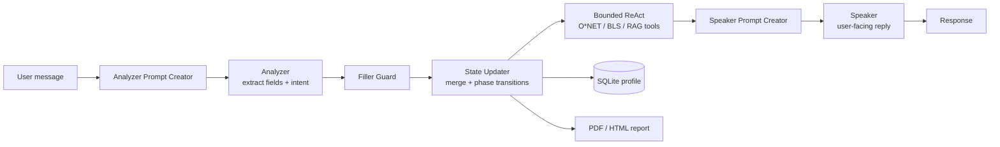

# Career Guidance AI Assistant

A conversational AI career coach that takes a user from "where am I today?" to an exportable, evidence-backed career plan. Built with **LangGraph (TypeScript)**, **Gemini**, and live U.S. labor-market data from **O\*NET** and **BLS**.

> Final project for **MGMT 59000: Emerging Tech in Business**, Purdue University (Spring 2026).

**Live demo:** https://career-guidance-ai-4aig.onrender.com *(Render free tier, first load may take ~30-60s to wake up)*

---

## The Problem

Career guidance is usually either generic (job-board listicles) or expensive (1:1 coaching). Users switching roles need three things in one place:

- An honest read of **which roles fit** their background
- A **skill gap analysis** grounded in real occupational requirements, not LLM guesses
- A **concrete plan** they can take away and act on

## What It Does

The assistant runs a structured 4-phase conversation, with each phase governed by config rather than hard-coded logic:

| Phase | Goal | Output |
|---|---|---|
| 1. Orientation | Learn background, education, and session goal | User profile |
| 2. Career Exploration | Surface 2-4 candidate directions from interests | Shortlist of roles |
| 3. Role Targeting | Confirm target role, self-rate skills vs O\*NET requirements | Skill gap analysis |
| 4. Planning | Synthesize gaps into an action plan | Downloadable PDF/HTML report |

### Key Features

- **Grounded skill requirements:** pulls skills and tasks from O\*NET Web Services; wage data from BLS
- **RAG over occupation data:** FAISS vector search over enriched occupation chunks
- **Resume upload:** parses an uploaded resume to pre-fill the profile
- **Role switch and role compare:** pivot to a new target role without losing confirmed facts
- **No-repeat memory:** confirmed facts and skill ratings are locked so the bot does not re-ask
- **Safety and topic guards:** keeps the conversation on career guidance
- **Exportable report:** PDF and HTML career plan with an evidence pack showing data sources
- **Returning users:** SQLite-backed profile persistence and session history
- **Observability:** optional LangSmith tracing

---

## Architecture

Each user turn flows through a LangGraph pipeline that separates **understanding** (Analyzer, temp 0) from **responding** (Speaker):



- **Config-driven agent:** phases, transition rules, prompts, and per-phase skills live in [`agent_config/`](agent_config/) (`phase_registry.json`, `state_schema.json`, `skills/**`)
- **Architecture history:** versioned diagrams v1.0 to v4.0 in [`docs/architecture/`](docs/architecture/) and [`ARCHITECTURE_DIAGRAMS.md`](ARCHITECTURE_DIAGRAMS.md)

## Tech Stack

| Layer | Tools |
|---|---|
| Agent orchestration | LangGraph, LangChain (TypeScript) |
| LLM | Google Gemini (default), Groq as optional fallback |
| Retrieval | FAISS (`faiss-node`), Ollama embeddings (optional locally) |
| Data sources | O\*NET Web Services v2, BLS API, USAJOBS (feature-flagged) |
| Backend | Node.js 20+, Express 5, SQLite (`better-sqlite3`), Zod |
| Frontend | Vanilla JS single-page app (`public/`) |
| Reports | PDFKit, HTML generator |
| DevOps | Docker, Render, GitHub Actions CI |

---

## Getting Started

### Prerequisites
- Node.js 20+
- A Gemini API key (required)
- O\*NET and BLS API keys (recommended for live data; the app falls back to cached data in `data/`)

### Run locally

```bash
git clone https://github.com/ramanaprabhusana/career-guidance-ai.git
cd career-guidance-ai
npm install
cp .env.example .env      # then add GOOGLE_API_KEY (and O*NET / BLS keys)
npm start                 # web app at http://localhost:3000
```

`npm run dev` starts the interactive CLI version instead.

### Quality checks

```bash
npm run check   # typecheck + config validation + golden-path test + smoke test + eval fixtures
```

The same checks run in CI on every push and PR (`.github/workflows/ci.yml`).

### Deploy
Docker + Render config is included (`Dockerfile`, `render.yaml`). See [`DEPLOY.md`](DEPLOY.md) for environment variables and steps.

---

## API Overview

| Method | Endpoint | Purpose |
|---|---|---|
| POST | `/api/session` | Start a session |
| POST | `/api/chat` | Send a message |
| POST | `/api/upload` | Upload a resume |
| POST | `/api/session/:id/role-switch` | Switch target role |
| POST | `/api/session/:id/role-compare` | Compare two roles |
| GET | `/api/report/:id.pdf` | Download the career plan |
| GET | `/api/session/:id/evidence` | Data sources behind the plan |
| GET | `/api/health` | Health check |

## Project Structure

```
src/
  graph.ts            LangGraph pipeline definition
  server.ts           Express API
  nodes/              Analyzer, Speaker, State Updater, ReAct executor, guards
  services/           O*NET, BLS, USAJOBS, courses, resume parser
  report/             PDF / HTML / evidence-pack generators
  utils/              RAG, safety + topic guards, history, summarizer
  db/                 SQLite profile store
agent_config/         Phase registry, state schema, prompts, per-phase skills
data/                 Cached occupations, chunks, embeddings, curated resources
public/               Web UI
scripts/              Data sync, index build, config validation, evals
fixtures/             Evaluation profiles
docs/architecture/    Versioned architecture diagrams
```

## Engineering Practices

- **Change logs:** [`CHANGELOG_FEATURES.md`](CHANGELOG_FEATURES.md) and [`CHANGELOG_TECH.md`](CHANGELOG_TECH.md) record what changed, where, and why
- **Error and audit logs:** [`logs/`](logs/) tracks defects, fixes, and conflicts
- **Evaluation:** golden-path tests plus fixture-based evals on sample user profiles

## Limitations and Next Steps

- Free-tier hosting causes cold starts
- Skill levels are self-reported; resume-based validation is partial
- USAJOBS and web search connectors are built but disabled by default
- Planned: interview prep pipeline, richer course recommendations, multi-session progress tracking

---

## Team

| Name | GitHub |
|---|---|
| Ramana Prabhu Sana | [@ramanaprabhusana](https://github.com/ramanaprabhusana) |
| Niteen Tomar | [@niteentomar](https://github.com/niteentomar) |

Built as an academic project; not professional career advice. Occupational data courtesy of O\*NET (U.S. Department of Labor) and the U.S. Bureau of Labor Statistics.
